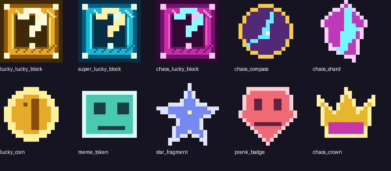

# GGLuckyEasy — GGLuckyEasy

**Version:** `v0.1.0-dev1` · **Minecraft Bedrock:** retail 1.26.30 (“26.3”) · **Android/iOS, two-player friendly**

A colorful, chaotic Lucky Block add-on for ordinary Survival worlds and optional free-play arenas. Place a block, break it, and discover one of **90 registered outcomes**. There are no rounds, countdowns, scores, leaderboards, forced endings, or automatic resets.



> **Development preview:** packages and automated checks are provided, but real Bedrock import, two-player, Android/iOS, and BlueStacks behavior remains unverified in the build environment. Back up important worlds. Terrain destruction is enabled by default and can be disabled.

## Install

### Combined package (recommended)

1. Download `GGLuckyEasy-v0.1.0-dev1.mcaddon` from `dist/` or the prerelease if one is published.
2. Open it with Minecraft Bedrock. Wait for both import messages.
3. Edit or create a world → **Behavior Packs** → activate **GGLuckyEasy Behavior**. Activate **GGLuckyEasy Resources** under Resource Packs. Mutual pack dependencies normally select both.
4. No experiment toggles are required. Enter the world and use the **Chaos Compass** for the quick guide.

Separate `GGLuckyEasy-Behavior-v0.1.0-dev1.mcpack` and `GGLuckyEasy-Resources-v0.1.0-dev1.mcpack` files are installation fallbacks. Import both.

### Android

Open the `.mcaddon` from Files/Downloads and choose Minecraft. If the file association is missing, use Minecraft’s open-with option or import the two `.mcpack` files. Do not rename the ZIP contents manually.

### iOS

Download in Safari → share/open the `.mcaddon` in Minecraft. If iOS saves rather than opens it, find it in Files → Share → Minecraft. Import both packs, then activate them on the world.

### Windows 10 + BlueStacks

BlueStacks runs the **Android Bedrock client**, not Minecraft for Windows. Put the `.mcaddon` in the BlueStacks shared Documents/Download folder, open it through the Android Files app, and select Minecraft. Activate both packs. Host keyboard shortcuts are optional; every add-on interaction is touch-compatible.

## Get and open Lucky Blocks

Creative inventory → **Items**, search “Lucky”. Operators can also use:

```mcfunction
/give @s luckychaos:lucky_block 1
/give @s luckychaos:super_lucky_block 1
/give @s luckychaos:chaos_lucky_block 1
/give @s luckychaos:chaos_compass 1
```

Place and break the block. One successfully broken block creates exactly one outcome and does not drop itself. There are **no crafting recipes, natural generation, random deposits, or automatic distribution**.

| Tier | Identity |
|---|---|
| **Lucky Block** | Gold; forgiving, reward-leaning table; 83 eligible events. |
| **Super Lucky Block** | Cyan; more special rewards and encounters; 89 eligible events. |
| **Chaos Lucky Block** | Magenta/cyan; every event eligible, with more hazards and special events—not universally stronger loot. |

Exact individual probabilities and bilingual descriptions: [EVENT_CATALOG.md](EVENT_CATALOG.md).

## Modes and profiles

Use a **Chaos Compass** → **World settings** (world operators only):

- **Survival Free:** ordinary Minecraft remains unchanged; open blocks whenever and wherever you choose.
- **Minigame Free Arena:** the same unrestricted play, with an optional one-time operator-built 25×25 platform at the operator’s position. The complete volume is validated first: occupied or protected areas are rejected, and there is no automatic arena reset.
- **Co-op:** a nearby second player receives a small, separately saved assist-XP/discovery reward when the opener succeeds.
- **Versus:** no assist XP; each player keeps independent XP, skills, discoveries, and inventory. Rivalry is player-driven, with no competition system.

Modes and profiles work in either combination and never disable any tier.

## Progression

Opening a block earns XP; a first-time event discovery earns a bonus. Rare/special outcomes earn extra XP. Level 2 requires 40 XP; each next level adds 25 XP to the requirement. Each level grants one skill point.

- **Fortune:** three ranks; increasing chance of one bonus emerald after an opening.
- **Vitality:** three ranks; stronger temporary absorption after an opening.
- **Insight:** three ranks; +3 XP per rank for new discoveries.

Upgrade costs begin at 2 points and increase by one per owned rank. Open the Compass → **Skill upgrades** or **Event collection**. XP, levels, skills, discoveries, and settings are saved per world using versioned dynamic properties. No daily tasks or timers exist.

## Safety and configuration

- **Allow terrain destruction:** enabled by default for the requested chaos. Disabling it substitutes non-destructive effects and prevents pit/TNT/explosion block damage.
- **Allow player-targeted pranks:** controls swaps and random teleports.
- Structures validate their full volume and never overwrite player construction, regardless of the destruction setting.
- Event block operations and spawns are bounded. Temporary patches use a reload-safe journal and preserve later player edits. Boss ownership and offline rewards use durable storage.
- Back up important worlds before playing. Powerful Chaos events can include TNT, lightning, explosions, and a Wither.

## Two-player multiplayer

1. The host activates both packs on the world.
2. The second Bedrock 26.3 player joins through the normal Friends/LAN invitation flow.
3. The host selects Co-op or Versus with the Compass. Both players can open blocks independently.
4. The server selects outcomes and saves each player’s progression separately.

Actual two-client synchronization remains **UNVERIFIED** until the procedure in `TEST_PLAN.md` is run on real clients.

## Troubleshooting

- **Pack will not activate:** confirm Minecraft is 1.26.30 or newer and both packs imported. Remove older duplicate GGLuckyEasy packs before reimporting.
- **Compass/menu does not work:** verify the Behavior Pack is active and scripts were not blocked by the world/host settings. No Beta APIs toggle is needed.
- **Block does nothing:** report the tier, coordinates, outcome attempt, and content-log error. A failed event is isolated and should not disable later blocks.
- **Vietnamese text looks wrong:** select `vi_VN` (Tiếng Việt) in Minecraft language settings; the pack registers this custom language name and English is the fallback. The source language files are UTF-8.
- **Too much destruction:** disable terrain destruction in Compass settings and restore a backup if needed.
- **Import fallback:** import the separate Behavior and Resource `.mcpack` files.

## Development

```bash
npm ci
npm run validate
npm test
npm run test:probability
npm run build
# or all checks:
npm run audit
```

Build artifacts and SHA-256 hashes are written to `dist/`; machine-readable evidence is in `evidence/`. See `AGENTS.md`, `COMPATIBILITY.md`, and `TEST_PLAN.md` before changing content. Source is Apache-2.0 licensed; original generated art and sounds are included in the same project.
